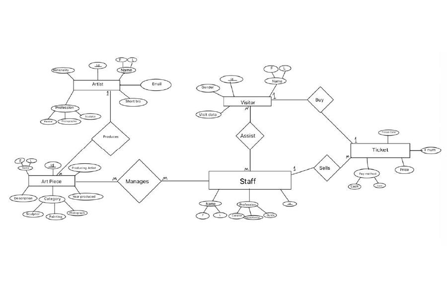

# Saudi Art Museum — Relational Database Project

A full relational database design and implementation for a fictional art museum, covering entity modeling, schema design, and SQL querying.

**Course:** Database course — Umm Al-Qura University
**Instructor:** Dr. Wajnat Rayes

## Overview

The Art Vision (Saudi Art) Museum manages artists, art pieces, staff, visitors, and tickets. The project designs a database to support ticketing, exhibition management, and staff assignment while capturing artist background, nationality, and specialization.

## Deliverable 1 — Design

- **Organization description** and business scenario
- **ER Diagram** modeling Artist, Art Piece, Staff, Visitor, and Ticket entities and their relationships (*Produces*, *Manages*, *Assist*, *Buy*, *Sells*)

- **Relational Schema** translating the ER diagram into tables, primary keys, and foreign keys

## Deliverable 2 — Implementation

Seven tables were created with primary/foreign key constraints, uniqueness constraints, and CHECK constraints:

| Table | Description |
|---|---|
| `staff` | Museum employees (curator, guide, receptionist) |
| `Visitor` | Museum visitors |
| `Ticket` | Ticket sales, linked to visitor and staff |
| `Artists` | Artist profiles (nationality, profession, bio) |
| `Art_Piece` | Artworks, linked to their artist |
| `Manages` | Many-to-many: staff managing art pieces |
| `Assist` | Many-to-many: staff assisting visitors |

## Deliverable 3 — Querying

The project demonstrates core SQL operations:
- **SELECT** with filtering (e.g., male visitors)
- **Aggregate functions** — `SUM` (total sales per staff member), `COUNT` (art pieces managed per staff member)
- **JOIN** — visitor and ticket details combined
- **Subquery** — identifying top-paying visitors
- **VIEW** — a consolidated `Ticket_Details` view joining tickets, visitors, and staff

## Tech Stack

MySQL · MySQL Workbench

## Repository Contents

- `saudi_art_museum.sql` — full DDL (table creation) and DML (sample data + queries)
- `er_diagram.png` — ER diagram

## My Contributions

- Wrote the organization description and designed the relational
schema

- Created the Visitor and Art_Piece tables

- Wrote the SELECT and subquery queries

- Organized and structured the project report

